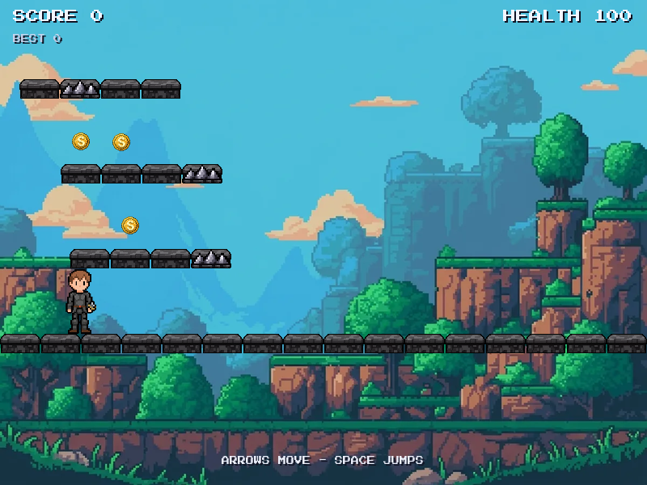

# Skyward Scramble

An endless climbing platformer built with **Pygame Zero**, rebuilt from an
early prototype. You hop between stone platforms, grab coins, and dodge the
spikes that keep multiplying. There is no finish line: survive, score, and
try to beat your own best run.



## Requirements

- Python 3.13 (3.9+ should also work)
- Pygame Zero

```bash
py -3.13 -m pip install -r requirements.txt
```

## Run it

```bash
py -3.13 -m pgzero main.py
```

`python main.py` works too, because the file calls `pgzrun.go()` when it is run
directly.

## Controls

| Action | Keys |
| --- | --- |
| Walk | `Left` / `Right` or `A` / `D` |
| Jump | `Space`, `Up` or `W` |
| Retry after game over | `Space` |

## How to play

- Touch a coin to score **1 point** and make a new coin respawn somewhere else.
- Every **5 coins** counts as one level: one more spike appears on the tower
  and the moving rows speed up. A short banner announces the change.
- Spikes cost **10 health** and **1 point**, with a brief invulnerability
  window so you are not hit twice in one touch.
- Health starts at **100**. At zero the run ends.
- Your high score is saved in `highscore.txt` next to `main.py` and shown as
  `BEST` in the corner.

## Features

- Endless high-score chase in the spirit of the Chrome dinosaur game: no win
  screen, only a game over and a reason to go again.
- Three floating rows above a solid ground row; the two upper rows slide back
  and forth and carry the player along with them.
- Coins respawn on free, spike-free tiles and mostly favour the high ground, so
  scoring means climbing.
- Frame-rate independent physics (speeds in pixels per second), one-way
  platforms, coyote time, jump buffering and a clamped delta time.
- Procedurally generated WAV sound effects and a pixel-font HUD.
- A headless self-test that exercises physics, pickups, hazards, difficulty,
  high-score saving and rendering.

## Project layout

```
main.py               the whole game
highscore.txt         created on the first completed run (not committed)
images/               background, player, platform, spikes, coin
sounds/               coin_pickup, jump, hurt, game_over, new_best, level_up
fonts/font.ttf        Press Start 2P
tools/build_assets.py rebuilds images/ from the prototype .webp artwork
tools/build_sounds.py synthesises every sound effect
tools/selftest.py     headless checks + screenshot.png
```

## Rebuilding the assets

Both generators are optional - the generated files are committed.

```bash
py -3.13 -m pip install pillow numpy
py -3.13 tools/build_assets.py "C:\path\to\prototype\artwork"
py -3.13 tools/build_sounds.py
```

`build_assets.py` crops the transparent padding from each prototype canvas,
resizes the tiles to 50x24, and writes PNGs (Pygame Zero prefers PNG). The
background is resized to the 800x600 window.

## Tests

```bash
py -3.13 tools/selftest.py
```

The self-test runs with SDL's dummy video/audio drivers, so it needs no window.
It prints one `PASS`/`FAIL` line per check, writes `screenshot.png`, and leaves
no `highscore.txt` behind.

## Credits

- Artwork: taken from the original prototype (`background`, `player`,
  `platform`, `spikes`, `coin`), trimmed and converted to PNG.
- Font: [Press Start 2P](https://fonts.google.com/specimen/Press+Start+2P) by
  CodeMan38, licensed under the SIL Open Font License 1.1.
- Sounds: synthesised with numpy by `tools/build_sounds.py`, so they carry no
  third-party licence.
- Built with [Pygame Zero](https://pygame-zero.readthedocs.io/) and Pygame.
